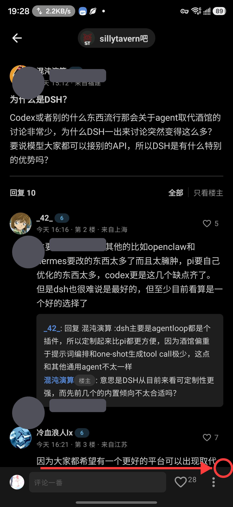
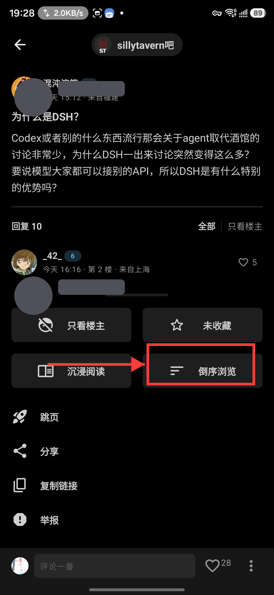

<p align="center">
  <a href="README.md">English</a> | <a href="README.zh-CN.md">简体中文</a> | <a href="README.ja.md">日本語</a> | <b>한국어</b>
</p>

# <p align="center">贴吧 Lite · TiebaLite</p>
<p align="center"><strong>비공식 바이두 티에바 Android 클라이언트 | 원탭 전체 체크인 · 3000+ 게시판 커버 | 스마트 업데이트 확인 · 초안 복원 | Android 5.0 → 16 전 세대 지원 | Compose · Kotlin · 광고 없음</strong></p>
<p align="center">
    <a href="https://github.com/qaqmin/TiebaLite/releases/latest">
        
    </a>
    <a href="https://github.com/qaqmin/TiebaLite/actions/workflows/build.yml">
        
    </a>
    <a href="https://github.com/qaqmin/TiebaLite/blob/4.0-dev/LICENSE">
        
    </a>
    
    
</p>

---

> ### 👤 메인테이너 근황 / Maintainer's Corner
> 이 저장소에 새 버전이나 버그 수정이 올라오지 않는 것처럼 보일 때, 메인테이너는 아마도 **여행 중, 배달 중, 게임 중, 소설 집필 중**이거나,
> **미국 / 한국 / 일본 주식과 외환 시장** 사이를 오가고 있거나, 실업 급여를 수령 중일 것입니다 — 삶의 각본은 결코 단일하지 않습니다.
>
> 하지만 안심하세요: **접수된 모든 버그는 하나하나 조사하고, 하나하나 수정합니다.**
>
> - 📱 **테스트 기기**: 삼성 Galaxy S 시리즈 플래그십 + Z Fold 시리즈(홍콩 롬)
> - 🚀 **향후 계획**: OPPO / vivo / 샤오미 실기 커버리지 추가 검토 예정
> - 🐉 **하모니OS 현황**: 현재 하모니OS 실기가 없어 하모니OS 쪽 버그는 단기적으로 특정 및 수정이 어렵습니다. 하모니OS 기기를 보유한 분은 언제든지 소스 코드를 내려받아 직접 수정에 도전해 주세요
>
> 📌 **계정 이전 공지(2026-10-04)**: 기존 GitHub 계정 **min09577** 이 불가항력적인 사유로 차단되었습니다(저장소가 모두 404).
> 본 프로젝트는 새 계정 **[[qaqmin09577](https://github.com/qaqmin09577/TiebaLite)** 으로 전체 이전했습니다.
> Codeberg 미러(min09577/TiebaLite)는 동기화를 계속하며 예비 업데이트 채널로 기능합니다.
> 앱 내 업데이트 감지의 기본 채널은 GitHub로 전환되었으며, 구버전 사용자도 그대로 업데이트를 받을 수 있습니다.
>
> 📌 **희생된 계정(2026-10-07)**: 이 프로젝트의 GitHub 계정은 두 차례 차단되었습니다 — 원래 계정 **min09577** 과 첫 번째 이전 계정 **qaqmin09577** 이 모두 불가항력적인 사유로 차단되어(저장소가 모두 404) 두 개의 희생된 계정이 되었습니다. 프로젝트는 현재 최신 GitHub 계정 **[[qaqmin](https://github.com/qaqmin/TiebaLite)** 과 Codeberg 미러에 존재하며, 구버전 사용자의 업데이트 감지에는 영향이 없습니다(주 채널 실패 시 예비 채널로 자동 폴백).

---

## ☕ 즉흥 후원 (Sponsor)

이 프로젝트는 여가 시간을 쪼개 '사랑의 힘'으로 써낸 것입니다. 모두에게 도움이 된다면 기쁩니다. 다만 프로젝트가 발전할수록 테스트로 소모되는 API 토큰이 예상을 훨씬 넘었고, 장시간의 디버깅도 적지 않은 휴식 시간을 들여놓았습니다(웃음).

이 프로젝트가 우연히 문제를 해결해 주거나, 삽질의 시간을 아껴주었다면 즉흥적으로 후원해 주세요. 후원금은 전부 높은 API 청구서를 '회복'하는 데 쓰이며, 이것이 제가 부담 없이 계속 업데이트할 수 있는 가장 큰 원동력입니다.

물론 전적으로 자발적입니다. 절대 부담을 느끼지 마세요. 잘 쓴다고 느끼시면 **Star** 하나만으로도 큰 격려가 됩니다.

<p align="center">
    
</p>

<p align="center"><i>바이낸스 수금 QR 코드 · Binance Wallet QR(USDT · BNB Smart Chain / BEP-20)</i></p>

---

## ✨ TiebaLite를 선택하는 이유 / Why TiebaLite

| 기능 | 설명 |
|------|------|
| 📝 **원탭 전체 체크인** | 스마트 페이지네이션으로 팔로우 중인 모든 게시판을 끌어와, 한 번의 실행으로 3000+ 게시판을 커버하고 알림바에 실시간 진행률 표시 |
| ⏰ **정기 자동 체크인** | Doze 대기 상태에서도 정밀 기상, 백그라운드 상주 제로, 정각에 전체 체크인을 자동 완료 |
| 📝 **초안 복원** | 답글은 자동 저장, 초안 목록에 게시판명/내용 미리보기 제공, 클릭 시 원글의 해당 층으로 직행 |
| 🔄 **역순浏览 · 글쓴이만** | 정렬 링크의 폴백이 전체 관통, 즐겨찾기 / 검색 페이지에서 진입해도 안정적으로 작동 |
| 🎯 **알림에서 원글로 직행** | '나에게 온 답글'을 한 번에 원글의 해당 층으로 점프, 맥락이 한눈에 |
| 🎬 **동영상 재생 원활** | 티에바 동영상 http→https 자동 업그레이드 + bdstatic 화이트리스트, 블랙박스를 완전히 돌파 |
| 🛡️ **내비게이션 크래시 제로** | 프로젝트 전체의 라우트 함정을 일소, 길게 눌러 복사 / 게시판 규칙 / 게시판 내 검색이 든든 |
| 🔍 **스마트 업데이트 확인** | GitHub Release 프로브 내장, 원탭으로 클라우드 버전 비교, release APK 직링크 다운로드 |
| 🖼️ **이미지 일괄 다운로드** | PhotoView 다중 선택 모드, 페이지를 넘나며 선택하고 한 번에 전부 저장 |
| 📋 **앱 내 로그 창** | 정보 페이지에서 원탭 진입, 주요 작업을 실시간 기록, 복사·공유로 문제 해결 지원 |
| 🚫 **광고 제로** | 배너 없음, 홍보 없음, 피드 광고 없음, 순수한浏览 경험 |
| 🎨 **Material Design** | Jetpack Compose로 구축, 네이티브 Material You 다이내믹 테마 |
| ⚡ **가볍고 부드러움** | APK는 약 10MB, 적응형 주사율, 여분 기능 없음 |
| 🔒 **프라이버시 우선** | 추적 없음, 바이두 티에바 API와만 통신 |
| 📱 **초장기 세대 지원** | Android 5.0(API 21)부터 Android 16(API 36)까지, 11년의 시스템을 전면 커버, 16KB 페이지 정렬 지원 |
| 👥 **다중 계정 전환** | 아바타를 클릭하면 원탭으로 계정 전환, 다중 계정 관리 지원 |
| 📐 **콘텐츠 밀도 조절** | 컴팩트 / 표준 / 편안한 3가지 간격 모드 |
| 💾 **오프라인 캐시** | 네트워크가 끊겨도 캐시된 게시글 목록을 자동으로 불러옴 |
| 🏗️ **현대적 기술 스택** | Kotlin 2.0.21 + Compose BOM 2024.12 + Hilt + Protobuf |
| 📦 **원탭 설치** | [릴리스 페이지](https://github.com/qaqmin/TiebaLite/releases/latest)에서 APK를 바로 다운로드 |

---

## 📖 소개

TiebaLite는 **비공식** 바이두 티에바 Android 클라이언트입니다. Kotlin으로 작성되고 UI는 Jetpack Compose로 구축되었습니다. **Android 5.0부터 Android 16**까지의 초장기 다양한 기기를 지원하며 16KB 페이지 정렬에도 완벽히 대응합니다. 본질적으로 바이두 티에바 API의 역공학 구현이며, 핵심浏览 경험을 희생하지 않으면서 가장 가볍고 깔끔한 티에바 클라이언트를 제공하는 것을 목표로 합니다.

> **⚠️ 고지:** 본 소프트웨어와 소스 코드는 학습·교류 목적으로만 사용 가능하며, 상업적 이용은 엄격히 금지됩니다. 바이두 회사와는 아무런 관련이 없습니다.

## 🆕 v4.0.60 — 앨범이 닫히지 않음 수정(issue #1 근본 원인)

> ### 🖼️ 선택 확인 후 답글로 정상 복귀
> 「이미지는 삽입되지만 앨범 페이지가 닫히지 않음」문제를 수정했습니다 — issue #1의 초기 증상으로, 실제 기기와 에뮬레이터 모두에서 재현되었습니다: 이미지 선택기가 한 번의 탭에 두 번 실행되었습니다. 전역 이벤트 버스 구독이 불안정한 effect key를 사용해 재구성 시 새 수집기와 오래된 수집기가 겹치고, 같은 이벤트로 실행이 두 번 호출되어 선택기 두 개가 쌓였습니다. 확인하면 아래의 빈 인스턴스가 나타났습니다. 버스 구독을 상시 단일 수집기로 변경하고 실행에 재진입 방지를 추가했습니다.

## 🆕 v4.0.59 — 첫 선택 실패 수정(issue #1 후속)

> ### 🖼️ 첫 번째 선택부터 성공
> 실제 기기에서 「첫 이미지 선택이 항상 실패하고 두 번째에야 성공하는」문제를 수정(Redmi K70 / HyperOS 실측, 10회 중 5회 재현): 선택기를 열면 App이 백그라운드로 전환되고 ROM이 프로세스를 회복하거나 Activity를 재구성하면 패널의 요청 id가 바뀌고, 이전 id를 가진 결과가 필터에서 버려졌습니다. 전체 선택 이벤트의 소비자는 하나뿐이므로 id 필터를 제거했습니다.
> v4.0.58은 에뮬레이터(Android 12) 선택기 미해결 문제를 수정했고, 이 버전은 실제 기기의 첫 선택 실패를 수정합니다.

## 🆕 v4.0.58 — 이미지 선택기 호환성 수정

> ### 🖼️ 어디서나 이미지 추가 가능
> Android 12 일부 ROM(MuMu 에뮬레이터 등)에서 「이미지를 추가할 수 없는」문제를 수정:这些 ROM은 사진 선택기 모듈을 포함하고 있지만 picker activity가 실제로 해석되지 않아 탭해도 반응이 없었습니다. 이제 시작 전 intent가 해석 가능한지 확인하고, 불가능하면 내장 선택기로 대체합니다.
> 실제 기기(Android 13+)의 시스템 사진 선택기는 영향이 없습니다.

## 🆕 v4.0.57 — 답글 및 누각 이미지 수정(issue #1)

> ### 🖼️ 이미지가 제대로 보이도록
> 「답글에 이미지를 추가해도 반응이 없는」문제를 수정: 이미지 선택 결과 구독에 재구성 경쟁이 있었습니다(불안정 키로 재구독이 반복되어 구독자 없는 틈에서 이벤트가 유실). 안정적인 단일 구독으로 변경하고 빈 결과 로그를 추가했습니다.
> 누각 이미지가 데이터 이상 시 공백으로 렌더링되던 문제를 수정: 빈 URL / 잘못된 크기를 방어하고 로그를 남깁니다.
> 문제가 계속되면 앱 로그(정보 페이지 → 로그 보기 → 복사)로 알려주세요. 주요 경로에 진단 로그를 추가했습니다.

## 🆕 v4.0.56 — 업데이트 채널 새 계정으로 이전

> ### 🔀 채널 이전
> 앱 내 업데이트 감지의 GitHub 채널이 새 계정 **qaqmin/TiebaLite** 을 가리키도록
> 변경되었습니다(이전 계정 qaqmin09577 은 차단됨). Codeberg 예비 채널은 그대로입니다.
> README의 다운로드入口·배지·Issues 링크도 새 계정으로 동기화되었습니다.

## 🆕 v4.0.55 — 업데이트 확인 강화 · 깔끔한 빌드 산출물

> ### 🔄 더 똑똑한 업데이트 확인
> 업데이트 확인이 ETag 조건부 요청을 사용합니다——304 응답은 GitHub의 익명
> 제한(시간당 60회/IP)에 집계되지 않아 403에 걸릴 확률이 크로 낮아집니다.
> 실패 시에는 기존대로 Codeberg 예비 채널로 자동 폴백됩니다.
>
> ### 🧹 더 깔끔한 빌드 산출물
> Gradle clean 태스크가 모든 서브모듈의 build 디렉터리를 삭제합니다
> (이전에는 루트만 삭제). 이전 버전의 APK가 이후 빌드 산출물에 섞이지 않습니다.

## 🆕 v4.0.54 — 계정 이전 · GitHub 메인 채널 가동

> ### 🏠 새 보금자리: qaqmin09577/TiebaLite
> 기존 min09577 계정이 불가항력적인 사유로 차단되어(저장소 404) 프로젝트가 새 GitHub 계정으로 전체 이전했습니다.
> 앱 내 업데이트 감지의 기본 채널이 GitHub로 전환되고, Codeberg 미러는 예비 채널로서 병행 공개를 계속합니다.
> 정보 페이지와 프로젝트 정보도 동기화 업데이트되며, 서명 키는 그대로이므로 덮어쓰기 업데이트가 seamless하게 이어집니다.

## 🆕 v4.0.53 — 빌드 라인 전환 · Mac 원격 빌드 기계의 안정적 산출

> ### 🛠️ 공개 링크 강화
> 빌드 라인을 Mac 원격 빌드 기계로 전환(Codeberg CI 변동기의 안정적 산출 라인),
> 전체 release 빌드는 약 27분에 완료되고 서명은 로컬 빌드와 비트 단위로 동일.

## 🆕 v4.0.52 — 시맨틱 버전 시리즈 · 앱 내 듀얼 채널 업데이트

> ### 🔄 버전 체계와 업데이트 경험의 동시 업그레이드
> 버전 번호를 v4.0.0-ai.N 체험판 시리즈에서 v4.0.N 시맨틱 버전 시리즈로 전환.
> 앱 내 업데이트가 Codeberg / GitHub 듀얼 채널을 지원하고 정보 페이지에서 채널을 선택할 수 있으며,
> 시작 시 업데이트 확인 실패는 예비 채널로 조용히 폴백되고, stable 채널은 releases 목록에서 최신 정식 버전을 필터링.

## 🆕 v4.0.0.50 — 화제 랭킹 전체 목록 페이지 클릭 가능

> ### 🧭 '더 많은 화제'도 이제 클릭됩니다
> 화제 랭킹의 두 번째 진입구성을 보완: 전체 목록 페이지의 항목을 클릭하면 검색 페이지로 점프하고,
> 페이지 내 화제 카드와 동일한 전환 방식이며 특수문자도 무손실(#39).
> 인기 화제 랭킹이 전체 링크에서 클릭 가능해져 남은 사각지대가 없습니다.

## 🆕 v4.0.0.49 — 인기 화제 카드 클릭 가능

> ### 🔥 화제 랭킹을 누르면 결과가 나옵니다
> 인기 화제 랭킹 카드의 클릭 무응답을 수정: 화제 카드를 클릭하면 자동으로
> 검색 페이지로 점프해 해당 화제를 검색하고, 특수문자가 포함된 화제명도 무손실 점프(#39).

## 🆕 v4.0.0.48 — 누각의 이미지 포함 댓글 완전 렌더링

> ### 🖼️ 누각 속 이미지가 마침내 보입니다
> API 클라이언트 버전 번호 업그레이드 후 이미지 포함 댓글이 완전한 이미지 데이터를 하달——
> 실제 이미지 렌더링 + 클릭 시 크게 보기, 더 이상 '[이미지]' 플레이스홀더가 아닙니다(#27).
> 미지의 콘텐츠 유형은 로그 폴백으로, 공식 데이터 형식의 변화를 지속적으로 관측 가능.

## 🆕 v4.0.0.47 — 홈 화면 하단바 내비게이션 적용

> ### 📱 홈 하단바, 다크 모드에서도 착착
> 홈 화면 하단 내비게이션 바가 시스템 내비게이션 바에 적응: 배경색이 세이프 영역까지 확장되고,
> 다크 모드에서 투명한 단층이 더 이상 나타나지 않으며, 제스처 내비게이션은 28dp의 결정론적 폴백(#36).
> 3버튼 내비게이션 기기는 시각적 변화가 없고 홈의 모든 탭이 든든합니다.

## 🆕 v4.0.0.46 — 이미지 뷰어 몰입형 전환 + 목록 스크롤 위치 기억

> ### 🖼️ 이미지를 봐도 튀지 않고, 몰입도 놀라지 않게
> 이미지 뷰어의 출입이 시스템 전환으로 변경: 상태바가 부드럽게 페이드인·아웃되고,
> 공유 패널의 왕복도 몰입 상태를 안정적으로 유지해 '튀는 현상'과 작별(#34).
>
> ### 📍 사용자 페이지에 갔다 와도 원래 자리에
> 누각과 원글 층 목록에 스크롤 위치 기억을 추가——
> 프로필에 들어갔다 돌아와도 떠난 그곳에 멈춰 서서 다시 찾을 필요가 없습니다(#8).

## 🆕 v4.0.0.45 — 누각 답글 바인딩 수정 + 게시판명 라우팅 강화

> ### 🎯 누구에게 답글하는지, 누구에게 답글됩니다
> 누각 답글의 강등을 수정: 답글 라우트가 subPostId의 소비를 보완해,
> 누각 내 댓글에 대한 답글이 대상을 정밀히 잠금하고 더 이상 층으로 강등되지 않습니다(PR#33 후속 강화).
>
> ### 🛡️ 특수 게시판명에도 라우트가 흐트러지지 않음
> 3곳의 답글 내비게이션에서 게시판명 파라미터에 인코딩을 보완해 `&` / `#` / 공백 등의 특수문자가
> 라우트를 파괴하지 않습니다——기존의 인코딩 규범과 완전히 일치.

## 🆕 v4.0.0.44 — 시작 페이지 커스텀 + 누각 이미지 플레이스홀더

> ### 🚀 켜자마자 보고 싶은 페이지
> '시작 페이지' 설정을 추가: 홈 / 피드 / 메시지 / 내 정보 중 하나를 시작 기본 페이지로 선택하고,
> '피드 진입 숨기기'와 연동 폴백되어 어떻게 설정해도 경계를 넘지 않습니다(#30).
>
> ### 🖼️ 누각의 이미지 포함 댓글, 하나도 놓치지 않음
> 콘텐츠 렌더링이 새로운 이미지 유형을 보완해 이미지 포함 댓글이 더 이상 조용히 버려지지 않고,
> 미리보기 줄에 '[이미지]' 플레이스홀더 안내를 추가하고 상세 페이지 이미지는 클릭하여 크게 보기 지원(#27).

## 🆕 v4.0.0.43 — 층 답글 위치 지정 수정 + 답글 페이지 상태바 회피

> ### 💬 모든 답글이 있어야 할 층에
> '첫 번째 누각이 될 수 없음'을 수정: 층 답글의 위치 지정 파라미터가 더 이상 유실되지 않고,
> '댓글' 클릭이나 '답글' 길게 누르기의 내용이 해당 층의 누각으로 직행해 원글에 잘못 올라가지 않습니다(#26).
>
> ### 📐 답글 페이지 상단바, 상태바와 더 이상 싸우지 않음
> 답글 편집 페이지의 상단 회피를 보완해 제목과 상태바가 안전 거리를 유지하고,
> 밝은/어두운 테마에서 일관된 동작을 보이며, 3개의 답글 링크가 실기 회귀 테스트를 통과하고 크래시 제로(#29).

## 🆕 v4.0.0.42 — 좋아요 목록 완전呈现

> ### 👍 받은 좋아요, 하나하나 선명하게 보입니다
> '받은 좋아요' 목록의 빈 화면 문제를 수정: 좋아요 메시지에 전용 데이터 모델을 구축해,
> 좋아요 누른 사람의 아바타, 닉네임, 시간과 '회원님의 게시글을 좋아함: 제목'이 완전히呈现되고,
> 두 대의 실기에서 검증되어 실제 데이터가 전체 렌더링되고 전 과정 크래시 제로(#16).
>
> ### 🧭 모든 좋아요가 근원까지 추적 가능
> 항목을 클릭하면 좋아요 받은 게시글로 직행하고 아바타를 클릭하면 좋아요 누른 사람의 홈으로,
> 빈 상태 폴백, 새로고침과 페이지네이션 중복 제거, 널 값 방어 강화를 동시에 추가해
> 목록 경험이 '나에게 온 답글'과 완전히 일치.

## 🆕 v4.0.0.41 — 제스처 핫존 2차 강화

> ### 🎯 시스템 보고에 더 이상 의존하지 않고, 회피가 '결정론적'으로 작동
> 일부 ROM(ColorOS 16 등)은 제스처 내비게이션에서 `navigationBars`와
> `safeGestures`를 동시에 0으로 보고하여 inset 기반 회피가 무효화됩니다.
> 통합 하단바 세이프 영역 컴포넌트를 도입: 실제 값을 우선하고, **둘 다 0일 때는 28dp의 제스처 핫존 높이로 결정론적 폴백**을 사용하며,
> 회피 영역 내에서 클릭을 능동적으로 소비해 관통을 근절.
>
> ### 📋 '더 보기' 팝업도 함께 강화
> 오터치의 '글쓴이만 / 즐겨찾기' 옵션은 하단 팝업에 위치——이번에 해당 부분에도 제스처 핫존 회피를 보완해
> 팝업 내용이 핫존에서 전체적으로 들어 올립니다(#20).

## 🆕 v4.0.0.40 — 신고 점프 수정 + 전체화면 제스처 회피

> ### 🧭 신고 절차, 한 번에 완료
> 신고 성공 후 웹 점프의 보간 누락을 수정하고 점프 주소도 통합 인코딩 규범에 편입해,
> 신고의 닫힌 고리 절차가 완전히 복구.
>
> ### 🖐️ 제스처 내비게이션, 하단의 오터치 없음
> 전체화면 제스처에서 게시글 하단을 클릭하면 '글쓴이만 / 즐겨찾기'를 오터치했습니다——근본 원인은 하단바 회피가
> 시스템 내비게이션 바만 계산하고 제스처 핫존을 놓친 것이었습니다. 이제 두 가지를 동시에 회피하고
> (`navigationBars ∪ safeGestures`), 제스처와 3버튼 내비게이션 모두 올바르게 동작하며,
> 누각 페이지도 동기 강화(#20).

## 🆕 v4.0.0.39 — 특수문자 라우팅 강화

> ### 🛡️ 복사와 외부 링크, 이제부터 든든합니다
> 링크가 포함된 답글을 복사하거나 게시글 내 웹 링크(클라우드 저장소 링크 등)를 클릭하면 순간 크래시——
> 근본 원인은 링크와 특수문자(`/ ? & :`)가 URI 인코딩 없이 내비게이션 라우트에 끼워 넣어져
> 라우트 매칭 규칙을 파괴한 것(#19).
>
> ### 🔐 전체 링크 인코딩, 왕복 무손실
> 복사 대화상자와 웹 라우트의 파라미터가 통일 `Uri.encode`로 인코딩 전달되고 6곳의 호출 지점을 한 번에 수렴시켜,
> 층 복사, 누각 복사, 외부 링크 점프 및 비디오 카드 등 모든 동족 경로를 커버하고,
> 읽기 측은 프레임워크가 자동 디코딩하여 한글(中文), 공백, 이모지, 전체 URL이 모두 원형 그대로 복원.

## 🆕 v4.0.0.38 — 시작 안정성 리팩터 + 즐겨찾기 선호 관통

> ### 🚀 콜드 스타트 크래시 근본 해결(커뮤니티 기여 합류 · 감사 @wufeng5702)
> 레드미 K50 / Note 11T Pro / Nothing Phone 2 등 기기의 '켜자마자 크래시' 난제가尘埃落定:
> 근본 원인은 `LocalNavigator`가 최상위 컴포지션 스코프에서 제공되지 않아 내비게이션 컨텍스트가 일부 시작 경로에서 공중에 뜬 것이었습니다.
> 이제 `MainActivityV2`의 최상위 `CompositionLocalProvider`에서 전역 주입하고,
> `NotificationsPage`는 명시적 파라미터 전달, `HotPage`는 파라미터 섀도잉을 제거해 20여 곳의 읽기 지점을 모두 폴백(#6 / #9 / #17).
>
> ### 🧬 Java 21 API 순방향 호환
> `removeFirst()` / `removeLast()`를 통일 `removeAt()` 등가 표기로 대체해,
> 고버전 JDK의 빌드 산출물이 구버전 Android 런타임에서 `NoSuchMethodError`를 유발하는隐患을 회피.
>
> ### 🎛️ 즐겨찾기 페이지浏览 선호가 전체 링크에서生效
> '즐겨찾기에서 진입 시 기본 글쓴이만 / 기본 역순浏览' 두 스위치는 이전에 정의만 있고 초기화에 참여하지 않았습니다.
> 이제 `from=FROM_STORE` 라우트 전달 체인(Routes → MainActivity → 즐겨찾기 페이지 점프)을 관통시켜,
> 게시글 진입 즉시 선호를 적용하고, 새로고침 / 재시도 / 이어읽기가全程 즐겨찾기 컨텍스트를 휴대해 물러서지 않으며 수동 전환도 여전히 즉시生效(#3).

## 🆕 v4.0.0.37 — 답글이 내 홈으로 직행

> ### 🎯 프로필의 답글 진입이 정밀归位
> 프로필의 '답글' 통계 숫자가 이전에 로컬 데이터베이스 기본 키 `account.id`를 티에바 UID로 잘못 사용해
> 타인의 홈에 잘못 들어갔습니다. 이제 실제 티에바 UID `account.uid`로 변경.
>
> ### 📑 Tab 정밀 위치 지정
> '답글' 클릭이 사용자 상세 페이지의 '답글' 탭(`user/{uid}?tab=1`)으로 직행하고,
> 3단계 Composable 함수(Page → Content → Normal/Expanded) 파라미터 체인이 관통되어 수동 전환이 필요 없음.

## 🆕 v4.0.0.35 — 답글 클릭 복귀

> ### 🎯 프로필의 답글 진입 사용
> 프로필의 '답글' 통계 숫자는 이전에 아무런 응답이 없었으며 이제 점프 로직을 연결:
> 클릭 → 2단계 메뉴의 사용자 상세 페이지로 바로 진입해 기존의 답글 탭을 재사용.
>
> ### 🔗 2단계 메뉴의 답글 클릭이 통일 점프
> 2단계 메뉴의 '답글' 목록에서 내용(빨간색 영역)을 클릭하면 라우트 리터럴 함정으로 크래시했습니다:
> - `subposts/0`(하드코딩 threadId=0) → SubPostsPage 로드 실패
> - `thread/threadId`(리터럴而非변수) → 라우트 해석 크래시
>
> **수정 전략: 통일 `thread/{threadId}?postId={postId}&scrollToReply=true`로 변경**
> 답글 내용을 클릭하는 것은 원글을 클릭하는 효과와 같아, 모두 원글의 해당 층으로 직행.

## 🆕 v4.0.0.34 — 정기 체크인 시계 보정

> ### ⏰ 날짜 넘김 순연 메커니즘
> 이전에 정기 체크인이 간헐적으로 누락된 근본 원인은 `initAutoSign`의 시간 판단 로직에 있었습니다:
> - 오늘의 목표 시각이 이미 지남 → 바로 알람을 설정하지 않음(누签到)
> - 알람 발화 후의 reschedule이 밀리초급 오차로 '이미 지남'으로 판단 → 다음 날 예약을 하지 않음
>
> **수정 전략:**
> - 초 / 밀리초를 제로 클리어하여 판단 오차를 제거
> - 목표 시각이 지났으면 다음 날로 순연되어 알람이 항상 유효
> - 3곳의 호출을 커버: 앱 시작 / 알람 reschedule / 부팅 재시작
>
> 이제 체크인이 정시에 발화하고 전천후로 안정적으로 운용.

## 🆕 v4.0.0.33 — 정렬과 글쓴이만: 폴백 관통

> ### 🔄 `forumId` 폴백 링크 수정
> ThreadPage 내부에 forumId 변수 두 개가 장기간 혼용:
> - `forumId`(라우트 파라미터, 즐겨찾기 페이지 등 시나리오에서는 null)
> - `curForumId`(`forumId ?: forum.id` 폴백 값)
>
> 역순 버튼, 글쓴이만, 더 보기, LoadPrevious, onRefresh, onReload, 몰입 모드 등 **10곳**이 모두 맨 `forumId`를 잘못 사용해,
> 즐겨찾기 페이지나 검색 결과 등 시나리오에서 게시글에 진입할 때 `forumId=null → forum_id=0`,
> API가 이상을 반환하고 정렬이 무효화.
>
> **전부 `curForumId`로 이전**하여 티에바 데이터 구조의 로드 완료로 유효한 게시판 ID를 얻고, 정렬 링크가 완전히 관통.

### 📍 역순浏览 기능의 진입구

第一步: 게시글에 진입한 후, 하단 댓글 창 오른쪽의 **'⋮'** 메뉴 버튼을 클릭:



第二步: 팝업 메뉴에서 **'역순浏览'** 버튼을 찾아 클릭하면生效:



## 🆕 v4.0.0.32 — 메시지 답글 위치归位

> ### 🎯 알림이 원글의 맥락으로 직행
> '나에게 온 답글'의 알림을 클릭한 후, 본래 누각(SubPostsPage)으로 직점프를 시도했지만 알림 데이터에 `forumId` 필드가 없어,
> SubPostsPage의 API 호출이 실패하고 빈 페이지가 되었습니다.
>
> 수정 방안: **원글로 점프해 해당 층으로 자동 스크롤하는 방식으로 변경**. `thread/{threadId}?postId={postId}&scrollToReply=true`
> 세 파라미터가 갖춰져 이전의 층 위치 지정 능력을 재사용하여 한 번에 명中.
>
> 사용자 경험: 알림 클릭 → 원글 → 답글 받은 층으로 자동 위치 지정 → 맥락이 한눈에, 빈 화면과 작별.

## 🆕 v4.0.0.31 — 비디오 재생 링크 리팩터

> ### 🎬 이중 보험으로 비디오의 블랙박스를 돌파
> 티에바 비디오 링크는 대부분 http 평문이고 CDN 도메인 `bdstatic.com`이 네트워크 보안 화이트리스트에 없어,
> 시스템 레이어가 조용히 차단하고 비디오가 캄캄해졌습니다.
>
> **이중 보험 수정:**
> - **네트워크 구성 레이어**: `network_security_config.xml`에 `bdstatic.com`을 추가하여 평문 화이트리스트 확장
> - **플레이어 레이어**: `DefaultVideoPlayerController`가 네트워크 비디오 소스에 대해 http → https 자동 업그레이드를 실행
>
> http든 https 직링크든 모두 안정적으로 재생됩니다. 샤오미, 레드미, 삼성 등 주류 기기의 비디오 경험이 함께 복귀.

## 🆕 v4.0.0.30 — 길게 누르기 메뉴 크래시 일소

> ### 🔪 라우트 리터럴 함정을 일망타진
> 이전 여러 차례의 반복에 `navigator.navigate("Routes.XXX/$it")`이라는 오타가 흩어져埋藏——라우트 상수명이 그대로 텍스트로 URL에 끼워 넣어져 Compose 해석이 크래시闪退.
> 1회의 길게 누르기 '복사' 오류를 계기로 프로젝트 전체 grep 조사를 통해 **한 번에 5곳의 동류隐患를 수습**:
> - `SubPostsPage.kt` × 2(누각 복사 진입구)
> - `ThreadPage.kt` × 2(원글/층 복사 진입구)
> - `ForumThreadListPage.kt` × 1(게시판 규칙 진입구)
>
> 전부 `navigator.navigate("copy_dialog/$it")` 등의 올바른 형태로 변경.
> '복사'가 이제부터는 든든하게 착지하고 새어나감이 없습니다.

## 🆕 v4.0.0.29 — 게시판 내 검색 즉시 관통

> ### 🔎 새어나감 수정: 변수 리터럴 함정
> 게시판 내 검색 내비게이션의 전달이 본래 순수 문자열 리터럴——`forumName`과 `forumId`가 텍스트로 그대로 전달되고 변수 평가가 아니었습니다.
> 라우트가 받은 것은 "forumName" 두 글자而非 실제 게시판명이라 해석이 크래시闪退.
> 1줄의 `$` 보간 수정으로 변수가 즉시 평가되고 검색 진입구가 견고하게 복귀.

## 🆕 v4.0.0.27 — 초안함: 층 정밀回溯

> ### 📝 스마트 초안 엔진
> 답글 내용이 실시간으로 자동 디스크에 저장되고 종료即 저장. 초안함에 들어가면 **게시판명 + 내용 미리보기 + 저장 시간**을一覧하고 클릭하면 **원글의 해당 층**으로 직행——
> 더 이상 모호한 파편이 아닌, 정확한 맥락의 순간.
>
> ### 🔍 계층 연동 라우트 수정
> 누각, 답글 페이지, 게시글 점프의 3계층 라우트 파라미터가 전체 링크에서 관통. `forumId` / `postId` / `subPostId`가 더 이상 도중에 유실되지 않고,
> 매번의 점프가 목표 위치에 정밀히 명中.
>
> ### 📋 앱 내 로그 패널
> 정보 페이지 하단의 '로그 보기' → 실시간 작업 흐름을 기록하고 원탭 복사·공유를 지원. 문제 해결이 더 이상 추측에 의존하지 않음.

## 🆕 v4.0.0.19 — 스마트 업데이트 + 고우선 정기 체크인

> ### 🔍 스마트 버전 순시
> 정보 페이지에 GitHub Release 프로브를 내장하여 원탭으로 클라우드 공개와 비교. 빌드 해시 접미사(`+sha`)를 스마트하게 세정하고 시맨틱 버전 번호에 정밀 매칭.
> 업그레이드를 발견 즉시 **직링크 다운로드**와 **GitHub 진입구**의 이중 채널을 제공——시스템 브라우저에서 안전 점프하고 이상 링크는全程 `try-catch`로 수호하여 크래시를 근절.
>
> ### ⏰ 고정밀 정기 알람
> `AlarmManager.setExactAndAllowWhileIdle`(Android 12+)이 구식 `setRepeating`을 대체.
> 대기 상태에서의 정밀 기상: 프로세스가 지워져도, 기기가 Doze에 잠겨도, 시각이 되면 시스템이 여전히 강제로 체크인 서비스를 일으킵니다.
> 체크인 완료 후 다음 날의 알람을 자동으로 예약하여 **백그라운드 상주 제로, 전천후 정시**.

## 🆕 v4.0.0.16 — 누각 수정 + 덮어쓰기 설치

- 🏷️ **덮어쓰기 설치 준비 완료** — 서명 키를 통일 입고해 이제부터는 원활한 업데이트
- 🐛 누각의 '전체 답글 보기'가 빈 화면으로 표시되는 문제를 수정(라우트 파라미터 누락)

## 🆕 v4.0.0.13 — 이미지 일괄 다운로드

> 🖼️ PhotoView 다중 선택 모드: 다중 선택을 클릭 → 페이지를 넘나르며 선택 → 원탭으로 갤러리에 일괄 저장

## 🆕 v4.0.0.12 — 성능 최적화

- ⚡ 차단형 `RateLimitInterceptor` / `RetryInterceptor`를 제거하고 OkHttp의 네이티브 재시도를 복귀
- 🚀 스크롤 부드러움이 복귀하고 v4.0.0.5에서混入된 성능 퇴보를 수정
- 🗑️ 사용하지 않는 `OneKeySignInBean` 등의 임시 데이터 모델을 삭제

## 🆕 v4.0.0.11 — 서명 키 통일

- 🔧 서명 키의 불일치로 매번 업데이트마다 제거 후 재설치가 필요했던 문제를 수정
- ✅ **이 버전부터 이후 모든 버전을 덮어쓰기로 바로 설치 가능, 구버전의 제거가 필요 없음**

## 🆕 v4.0.0.10 — 전체 체크인 서纪

> ### ⚡ 원탭 전체 체크인
> 스마트 페이지네이션 엔진이 팔로우 중인 모든 티에바를 하나씩 끌어와 **단일 실행으로 최대 3000개의 게시판을 커버**.
> '공식 클라이언트는 처음 100개만 체크인'이라는 제한과 작별하고 어떤 게시판도 놓치지 않습니다.
>
> ### 🔋 ⚠️ 중요: 배터리 최적화를 꺼 주세요!
> 체크인 과정은 백그라운드에서 지속 실행이 필요합니다. **반드시 '贴吧 Lite'의 배터리 최적화 정책을 '제한 없음'으로 설정해 주세요**,
> 그렇지 않으면 시스템이 체크인 도중 프로세스를 강제 대기시켜 체크인이 중단될 수 있습니다.
>
> **설정 경로:** 시스템 설정 → 앱 → 贴吧 Lite → 배터리 → 제한 없음
>
> *(각 브랜드 휴대폰의 경로는 약간 다릅니다: 샤오미-앱 정보→절전 정책→제한 없음 / 화웨이-앱 시작 관리→수동 관리 / OPPO-vivo-전력 소모 보호→백그라운드 실행 허용)*

## 🆕 v4.0.0.5 업데이트 내용

- 🎮 적응형 고주사율 — 기기의 최고 주사율에 자동 매칭
- 👥 다중 계정 빠른 전환 — 사용자 페이지에서 아바타를 누르면 계정 메뉴가 팝업
- 📐 콘텐츠 밀도 옵션 — 컴팩트 / 표준 / 편안한 3가지 간격
- 💾 오프라인 캐시 — 네트워크가 끊길 때 캐시된 게시글을 자동으로 불러옴
- 🚀 Compose 성능 최적화 — Strong Skipping + 안정성 마킹
- 🔧 ProGuard R8 전체 모드 + ABI 선별
- 🛡️ API 안정성 강화 — 요청 재시도 + 빈도 제어
- 🖼️ 이미지 다운로드 안내 — 갤러리에 저장
- ✍️ 초안 알림 — 미전송 답글 수 표시
- 📋 체크인 강화 — 이중 데이터 소스를 병합해 더 많은 팔로우 게시판을 커버

## 💡 사용 팁 / Pro Tips

| 시나리오 | 제안 |
|------|------|
| 🔋 **전체 체크인** | 반드시 시스템 설정에서 이 앱의 배터리 최적화를 '제한 없음'으로 설정하여 백그라운드 프로세스 킬로 인한 체크인 중단을 방지 |
| ⏰ **정기 자동 체크인** | 활성화 후에는 앱을 백그라운드에 상주시킬 필요가 없고 Doze 대기에서도 정시에 기상합니다. 배터리 정책이 제한 없음인 것만 확인하면 됩니다 |
| 📝 **초안 자동 저장** | 답글 도중 종료即 저장되고 언제든 초안함에서 복원 가능. 새 버전 초안은 전체 맥락(게시판명+층)을 포함하고 클릭 시 직행 |
| 🔄 **앱 내 업데이트** | 정보 페이지 → 업데이트 확인 → Release 버전 APK를 다운로드하고, 다운로드 후 알림바를 누르면 설치 가능(구버전 제거 불필요) |
| 📋 **문제 해결 보조** | 정보 페이지 → 로그 보기 → 오른쪽 상단에서 복사 → issue 제출 시 로그를 첨부하면 반드시 도움이 됩니다 |
| 🌐 **다국어** | 중일한영 4개 국어의 UI와 문서를 완전 지원 |

## 💬 피드백과 기여 / Feedback & Contribution

🐛 버그를 발견했나요? 💡 좋은 아이디어가 있나요? GitHub Issues를 통해 제출해 주세요:

<p align="center">
    <a href="https://github.com/qaqmin/TiebaLite/issues">
        
    </a>
</p>

> 제출 시에는 **앱 로그**를 첨부해 주세요(정보 페이지 → 로그 보기 → 복사). 자세할수록 수정이 빨라집니다.

## 👨‍💻 원작자 / Original Author

이 프로젝트는 **[HuanCheng65](https://github.com/HuanCheng65)** 가 최초 개발하여 2024년 아카이브될 때까지 유지보수했습니다.

> 🙏 **모든 원본 코드, 아키텍처 설계, 핵심 기여는 원작자에게 귀속되며, 그들의 노고에 진심으로 경의를 표합니다.**

## 🔗 우정 링크

+ [Starry-OvO/aiotieba: Asynchronous I/O Client for Baidu Tieba](https://github.com/Starry-OvO/aiotieba)
+ [n0099/tbclient.protobuf: 바이두 티에바 클라이언트 Protocol Buffers 정의 파일 모음](https://github.com/n0099/tbclient.protobuf)

---

## 📋 버전 반복 기록 / Version History

| 버전 / Version | 날짜 / Date | 설명 / Description |
|---|---|---|
| v4.0.0-beta.1 | 2024-02-02 | 최초 버전 공개 / Original release by HuanCheng65 |
| v4.0.0.1 | 2026-06-09 | 문서 완성, 4개 국어 고지 |
| v4.0.0.2 | 2026-06-09 | 보안 수정, 네트워크 보안 구성 |
| v4.0.0.3 | 2026-06-09 | CI 수정, 빌드 성공 |
| v4.0.0.4 | 2026-06-12 | AGP 8.5.2 + Gradle 8.7 + 소스 수정 |
| v4.0.0.5 | 2026-06-13 | compose-destinations 제거 + Kotlin 2.0.21 + 전면 의존성 업그레이드 |
| v4.0.0.6 | 2026-06-14 | 다중 계정 빠른 전환 + 콘텐츠 밀도 + 오프라인 캐시 |
| v4.0.0.7 | 2026-06-14 | API 안정성 강화(재시도+빈도 제어) + 이미지 다운로드 안내 |
| v4.0.0.8 | 2026-06-14 | 체크인 전체 업그레이드(첫 시도) |
| v4.0.0.9 | 2026-06-14 | 체크인 아키텍처 재설계 · 페이지네이션으로 전체 팔로우 게시판 목록을 끌어옴 |
| v4.0.0.10 | 2026-06-14 | **🎉 원탭 전체 체크인 · 3000+ 게시판 완전 커버** — 페이지네이션 엔진 + 실패 스킵 내성 |
| v4.0.0.11 | 2026-06-15 | 서명 키를 통일하여 이제부터 덮어쓰기 설치 시 제거가 필요 없음 |
| v4.0.0.12 | 2026-06-15 | 성능 최적화 · 차단형 인터셉터 제거 · 스크롤 부드러움 복귀 |
| v4.0.0.13 | 2026-06-15 | **🖼️ 이미지 일괄 다운로드** — PhotoView 다중 선택 + 원탭 일괄 저장 |
| v4.0.0.15 | 2026-06-15 | keystore 화이트리스트 수정 · 덮어쓰기 설치 활성화 |
| v4.0.0.16 | 2026-06-15 | 누각 빈 화면 수정 · 라우트 파라미터 보완 |
| v4.0.0.19 | 2026-06-17 | **🔍 스마트 업데이트 + ⏰ 정기 체크인** — setExactAndAllowWhileIdle + 직링크 · Doze 기상 가능 |
| v4.0.0.22 | 2026-06-17 | **📦 Release 채널 수정** — 앱 내 업그레이드가 정식 버전 APK를 다운로드하도록(Debug 디버그 빌드가 아닌) |
| v4.0.0.24 | 2026-06-17 | **📝 초안함 완전 구현** — Draft 모델 확장 · 목록浏览 · 클릭 점프 |
| v4.0.0.27 | 2026-06-17 | **🎯 초안 위치 지정 + 로그 패널** — 클릭으로 해당 층에 직행 · 정보 페이지에 실시간 로그 창 |
| v4.0.0.29 | 2026-08-16 | 🐛 **게시판 내 검색 크래시 수정** — 변수 보간의 구멍을 보완 · 한 글자를 고쳐 전체적으로 안정 |
| v4.0.0.30 | 2026-08-16 | **🔪 라우트 리터럴 함정을 일망타진** — 프로젝트 전체 grep으로 5곳의 Routes. 오타를 조사 · 길게 누르기 복사 복귀 |
| v4.0.0.31 | 2026-08-16 | **🎬 비디오 재생 수정** — bdstatic 화이트리스트 + 플레이어 http→https 이중 보험 |
| v4.0.0.32 | 2026-08-16 | **🎯 알림 위치归位** — '나에게 온 답글'을 원글 점프로 변경 · 해당 층으로 자동 스크롤 |
| v4.0.0.33 | 2026-08-16 | **🔄 정렬 폴백 관통** — ThreadPage의 10곳 forumId → curForumId · 역순 복귀 |
| v4.0.0.34 | 2026-08-16 | **⏰ 정기 체크인 시계 보정** — 날짜 넘김 순연 메커니즘 + 밀리초 제로 클리어 · 세 곳의 호출을 통일 |
| v4.0.0.35 | 2026-08-16 | **🎯 답글 클릭 복귀** — 프로필 진입구 활성화 + 2단계 메뉴 답글 클릭이 통일 점프 |
| v4.0.0.36 | 2026-08-16 | **🎯 답글이 내 홈으로 직행** — account.uid 수정 + user/{uid}?tab=1 위치 지정 |
| v4.0.0.37 | 2026-08-16 | 🛠️ **컴파일 수정** — initialTab 3단계 함수 파라미터 체인을 보완 |
| v4.0.0.38 | 2026-08-30 | 🚀 **시작 안정성 리팩터** — LocalNavigator 최상위 주입으로 콜드 스타트 크래시를 근본 해결 · 즐겨찾기 선호 관통 · 커뮤니티 기여 #15 합류 |
| v4.0.0.39 | 2026-08-31 | 🛡️ **특수문자 라우팅 강화** — 링크 포함 콘텐츠 복사/외부 링크 점프 크래시를 근본 해결 · 여섯 곳의 호출 지점을 통일 Uri.encode |
| v4.0.0.40 | 2026-08-31 | 🧭 **신고 점프 수정 + 제스처 회피** — 신고 성공 웹 점프 복귀 · 하단바의 제스처 핫존 회피 · 오터치 근본 해결 |
| v4.0.0.41 | 2026-09-01 | 🖐️ **제스처 핫존 2차 강화** — 둘 다 0 inset일 때 28dp의 결정론적 폴백 · '더 보기' 팝업 회피 보완 |
| v4.0.0.42 | 2026-09-02 | 👍 **좋아요 목록 완전呈现** — '받은 좋아요' 빈 화면을 근본 해결 · 항목에서 게시글/홈으로 직행 · 빈 상태 폴백과 중복 제거 |
| v4.0.0.43 | 2026-09-05 | 💬 **층 답글 위치 지정 수정** — 층 답글이 누각으로 직행 · 답글 페이지 상태바 회피 · 3개 링크 실기 회귀 |
| v4.0.0.44 | 2026-09-07 | 🚀 **시작 페이지 커스텀 + 누각 이미지 플레이스홀더** — 시작 페이지 4선택 · 피드 숨김과 연동 폴백 · 이미지 포함 댓글 불유실 · 크게 보기 |
| v4.0.0.45 | 2026-09-08 | 🎯 **누각 답글 바인딩 수정** — 답글 대상을 정밀히 잠금 · 특수 게시판명 라우팅 강화 |
| v4.0.0.46 | 2026-09-08 | 🖼️ **이미지 뷰어 몰입형 전환 + 스크롤 위치 기억** — 상태바 부드러운 전환 · 공유 패널이 몰입 유지 · 돌아오면 원래 위치에 정지 |
| v4.0.0.47 | 2026-09-09 | 📱 **홈 화면 하단바 내비게이션 적용** — 다크 모드 중복 수정 · 배경이 세이프 영역으로 확장 · 제스처 핫존 폴백 |
| v4.0.0.48 | 2026-09-10 | 🖼️ **누각 이미지 포함 댓글 완전 렌더링** — API 버전 번호 업그레이드 · 실제 이미지 렌더링+클릭 크게 보기 · 미지 유형 로그 폴백 |
| v4.0.0.49 | 2026-09-09 | 🔥 **인기 화제 카드 클릭 가능** — 화제 카드가 검색으로 점프 · 특수문자 무손실 · 맨 내비게이션/deepLink 퇴보 없음 |
| v4.0.0.50 | 2026-09-11 | 🧭 **화제 랭킹 전체 목록 페이지 클릭 가능** — '더 많은 화제' 진입구성 보완 · 검색 점프 전환 방식 · 전체 링크 사각지대 없음 |
| v4.0.0-ai.50 | 2026-09-16 | 🧪 **ai 체험 채널 최초 공개** — 화제 랭킹 전체 목록 페이지 클릭 가능 · 체험판은 독립 버전 체계로, 안정 채널은 영향 없음 |
| v4.0.0-ai.51 | 2026-09-22 | 🧪 **CI 최초全绿 프리릴리스** — runner에 Android SDK 추가 설치 · jitpack TLS 재시도 · ButterKnife 잔여 제거 · 공개를 Codeberg 네이티브 API로 변경 |
| v4.0.52 | 2026-09-23 | **🔢 시맨틱 버전 시리즈** — 버전 체계를 v4.0.N으로 전환 · stable 채널이 releases 목록에서 최신 정식 버전을 필터링 |
| v4.0.53 | 2026-10-04 | **🛠️ Mac 원격 빌드 라인** — 빌드를 Mac 빌드 기계로 이전(CI 변동기의 안정적 산출 라인) · 서명은 로컬과 비트 단위로 동일 |
| v4.0.60 | 2026-10-16 | **🖼️ 앨범이 닫히지 않음 수정** — 이미지 선택기 이중 실행 수정(「이미지는 삽입되지만 앨범이 열린 채로」수정; issue #1 근본 원인) |
| v4.0.59 | 2026-10-16 | **🖼️ 첫 선택 실패 수정** — 선택 결과를 요청 id로 필터링하지 않음(HyperOS/Redmi K70 첫 선택 실패 수정; issue #1 후속) |
| v4.0.58 | 2026-10-16 | **🖼️ 이미지 선택기 호환성** — intent 해석 가능성 확인 + Matisse 대체(MuMu 등 Android 12 ROM의 이미지 추가 불가 수정) |
| v4.0.57 | 2026-10-16 | **🖼️ 답글·누각 이미지 수정** — 이미지 선택 구독 경쟁 수정(안정 수집) · 빈 URL/크기 방어 + 로그(issue #1) |
| v4.0.56 | 2026-10-07 | **🔀 업데이트 채널 이전** — GitHub 업데이트 채널이 qaqmin/TiebaLite을 가리킴(이전 계정 차단됨) · README 링크도 동기화 |
| v4.0.55 | 2026-10-07 | **🔄 업데이트 확인 강화** — ETag 조건부 요청(304은 익명 제한 미집계) + 403 자동 폴백 · clean 수정(stale APK가 산출물에 섞이지 않음) |
| v4.0.54 | 2026-10-04 | **🏠 새 계정 qaqmin09577으로 이전** — 기본 업데이트 채널을 GitHub로 전환 · Codeberg는 예비 채널로 전환 · 이중 트랙 공개 · 덮어쓰기 무영향 |
| [▶ 최신 릴리스](https://github.com/qaqmin/TiebaLite/releases/latest) | | **← APK 다운로드 여기 / Download APK here** |

---

## 🛠️ 빌드 설명 / Build Instructions

### 환경 요구사항 / Prerequisites

- **JDK 17+**
- **Android SDK** with **compileSdk 34**
- Android Studio(권장 / Recommended)

### 서명 구성 / Signing Configuration

Release 서명을 위해 `keystore.properties` 파일을 생성:

Create a `keystore.properties` file for release signing:

```properties
storeFile=your_keystore_file.jks
storePassword=your_store_password
keyAlias=your_key_alias
keyPassword=your_key_password
```

> ⚠️ **주의 / Note:** `keystore.properties` 파일은 버전 관리 시스템에 커밋하지 마세요. / Do NOT commit the `keystore.properties` file to version control.

### 빌드 명령 / Build Commands

```bash
# 디버그 빌드 / Debug Build
./gradlew assembleDebug

# 릴리스 빌드 / Release Build
./gradlew assembleRelease
```

빌드 산출물은 `app/build/outputs/apk/` 디렉터리에 위치합니다.

Build outputs are located in the `app/build/outputs/apk/` directory.

---

## ⚠️ 면책 고지 / Disclaimer

<details>
<summary>🇨🇳 中文</summary>

1. 本软件為**非官方**贴吧客户端，与百度公司无任何关联。
2. 本软件及源码**仅供学习交流使用，严禁用于商业用途**。
3. 使用本软件所产生的一切后果由使用者自行承担。
4. 本软件不保证功能的完整性和稳定性。

</details>

<details>
<summary>🇯🇵 日本語</summary>

1. 本ソフトウェアは**非公式**の贴吧クライアントであり、百度社とは一切の関係がありません。
2. 本ソフトウェアおよびソースコードは**学習・交流のみを目的としており、商業利用は厳禁**です。
3. 本ソフトウェアの使用により生じる一切の結果は、使用者自身が責任を負います。
4. 本ソフトウェアは機能の完全性と安定性を保証するものではありません。

</details>

<details>
<summary>🇰🇷 한국어</summary>

1. 본 소프트웨어는 **비공식**贴吧 클라이언트이며, 바이두와는 아무런 관련이 없습니다.
2. 본 소프트웨어およびソースコード는 **학습 및 교류 목적으로만 사용되며, 상적 사용은 엄격히 금지**됩니다.
3. 본 소프트웨어의 사용으로 인해 발생하는 모든 결과는 사용자가 책임을 집니다.
4. 본 소프트웨어는 기능의 완전성과 안정성을 보장하지 않습니다.

</details>

<details>
<summary>🇺🇸 English</summary>

1. This software is an **unofficial** Tieba client and is not affiliated with Baidu, Inc.
2. This software and its source code are **for learning and communication purposes only. Commercial use is strictly prohibited**.
3. All consequences arising from the use of this software are borne by the user.
4. This software does not guarantee the completeness and stability of its features.

</details>

---

<p align="center">
    <sub>원작자 / Original Author: <a href="https://github.com/HuanCheng65">HuanCheng65</a> | 라이선스 / License: GPL v3</sub>
</p>
